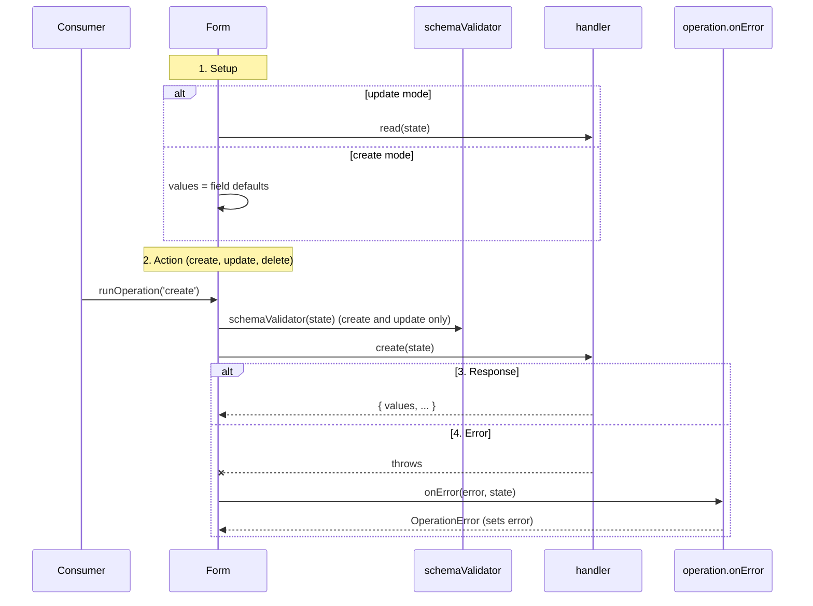

# Form lifecycle

How `Form` behaves from setup to a response, in both `@shilp.dev/react-form` and `@shilp.dev/vue-form`. The two packages follow the same steps. The matching numbered comments are in `packages/react/src/components/form.tsx` and `packages/vue/src/components/form.vue`, and every action goes through one `runOperation(key)` in both.

## Timeline

## Steps

### 1. Setup

- The options (`modeDetector`, `fieldsGenerator`, `schemaValidator`) are required props of `Form`; there are no defaults.
- `modeDetector({ itemId })` sets the mode. It is a required prop and has no default. If it returns anything other than `'create'` or `'update'`, a warning is logged (once per change of the mode) and the value is treated as `'update'`.
- The schema in use is `create.schema` in create mode and `update.schema` in update mode. `fieldsGenerator` turns it into fields (`{ name, label, value? }`).
- Update mode: `runOperation('read')` runs (step 2 without validation). Create mode: `values` are the field defaults (`field.value`, or `null`), and `touched` and `dirty` are emptied.
- Setup runs again whenever `itemId` changes, and on `refresh()`. Only `refresh()` first clears `response` and `error`; setup itself leaves them as they are. In React it runs in an effect, so React StrictMode reads twice in development.

### 2. Action

Every `runOperation(key)` call runs the operation with that key:

1. Sets the flag of its key (`isCreating`, ..., or `isRunning(key)`) and so `isLoading`.
2. Clears `error` and `fieldErrors`.
3. Only when the operation has a `schema`: calls `schemaValidator(state, operation)`, where `operation` is the one being run, so its `schema` is there. A rejection goes to step 5 and the handler is not called.
4. Calls the handler with the latest state, then stores the response (step 3 below) and calls the operation's `onSuccess(state)`. In React the state includes values set in the same event.
5. A rejection goes to `onError`: a `TypeError` is logged, and the operation's `onError(error, state)` runs. If it returns an `OperationError`, that sets `error` and `fieldErrors`; if the operation has no `onError`, or it returns nothing, they stay empty. The flag is cleared at the end either way.

The whole flow is one chain: `operation.handler(state).then(...store the response).catch(...onError).finally(...)`. The operations you use must be passed: calling an action whose operation is missing throws a `TypeError` straight away. If two operations share a `key`, a warning is logged and the first one is used.

### 3. Response

- `response` is stored.
- When the response has `values`, they are merged over the field defaults and become both `values` and `initialValues`; `touched` and `dirty` are emptied. Without `values` the form keeps what it has.

### 4. Error

- A `TypeError` is also logged with `console.error`, since it usually means a bug in a handler.
- `error` is what the operation's `onError(thrown, state)` returned, and `fieldErrors` is a copy of `error.fieldErrors`.
- Nothing is thrown to the caller.

The flag is turned off after step 3 or 4.

## Editing

- `setFieldValue(name, value)` sets the value, adds `name` to `touched`, adds or removes it from `dirty` by deep comparison with `initialValues`, and clears that field's error.
- `setFieldError` changes one field's error, `setFieldErrors(errors)` replaces all of them with `errors`, and `clearErrors` empties them. They change `fieldErrors` (and `clearErrors` also `error`) without a request.
- `reset()` goes back to the field defaults in create mode and to `initialValues` in update mode, and clears the errors.
