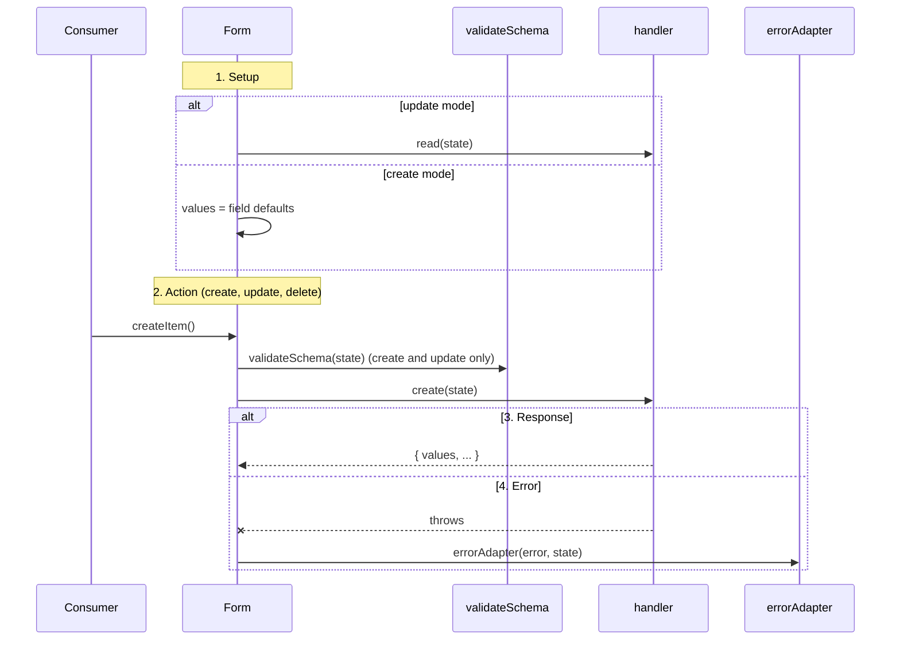

# Form lifecycle

How `Form` behaves from setup to a response, in both `@shilp.dev/react-form` and `@shilp.dev/vue-form`. The two packages follow the same steps. The matching numbered comments are in `packages/react/src/components/form.tsx` and `packages/vue/src/components/form.vue`, and each action is its own function in both.

## Timeline

## Steps

### 1. Setup

- Each option is the prop on the `Form`, or its default from `shared/options.ts` when the prop is not passed.
- `resolveMode({ itemId })` sets the mode. The default returns `create` for `undefined`, `null`, `''` and `'+'`, and `update` for anything else.
- The schema in use is `createSchema` in create mode and `updateSchema` in update mode when given, `schema` otherwise. `schemaToFields` turns it into fields (`{ name, label, value? }`).
- Update mode: `readItem()` runs (step 2 without validation). Create mode: `values` are the field defaults (`field.value`, or `null`), and `error` and `response` are cleared.
- Setup runs again whenever `itemId` changes, and on `refresh()`. In React it runs in an effect, so React StrictMode reads twice in development.

### 2. Action

Every action (`readItem`, `createItem`, `updateItem`, `deleteItem`):

1. Sets its flag (`isCreating`, ...) and so `isLoading`.
2. Clears `error` and `fieldErrors`.
3. `createItem` and `updateItem` only: calls `validateSchema(state)`. A rejection goes to step 5 and the handler is not called.
4. Calls the handler with the latest state, then `onResponse` (step 3 below). In React the state includes values set in the same event.
5. A rejection goes to `onError`: a `TypeError` is logged, and `errorAdapter(error, state)` sets `error` and `fieldErrors`. The flag is cleared at the end either way.

The whole flow is one chain: `handler(state).then(onResponse).catch(onError).finally(...)`. The handler props you use must be passed: calling an action whose handler is missing throws a `TypeError` straight away.

### 3. Response

- `response` is stored.
- When the response has `values`, they are merged over the field defaults and become both `values` and `initialValues`; `touched` and `dirty` are emptied. Without `values` the form keeps what it has.

### 4. Error

- A `TypeError` is also logged with `console.error`, since it usually means a bug in a handler.
- `error` is `errorAdapter(thrown, state)`, and `fieldErrors` is a copy of `error.fieldErrors`.
- Nothing is thrown to the caller.

The flag is turned off after step 3 or 4.

## Editing

- `setValue(name, value)` sets the value, adds `name` to `touched`, adds or removes it from `dirty` by deep comparison with `initialValues`, and clears that field's error.
- `setFieldError`, `setFieldErrors` and `clearErrors` change `fieldErrors` (and `clearErrors` also `error`) without a request.
- `resetForm()` goes back to the field defaults in create mode and to `initialValues` in update mode, and clears the errors.
